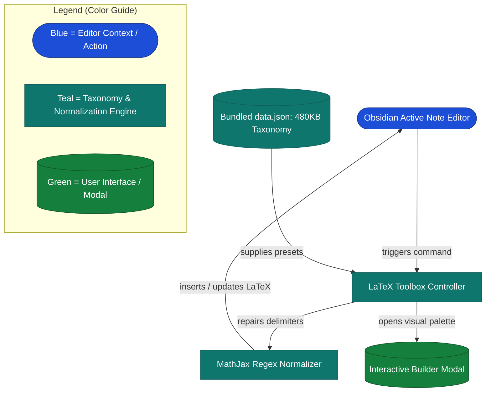
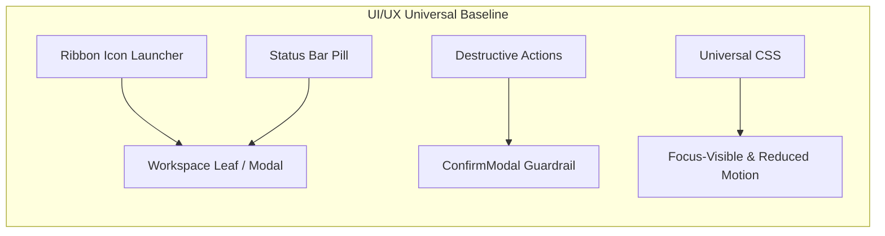

# System Architecture (`ARCHITECTURE.md`)
> **1-Line Summary:** Zero-dependency modular TypeScript architecture with pre-bundled curriculum taxonomy data.

## 1. High-Level Visual System Map

## 2. Tech Stack & Why We Chose It

| Layer | Tool / Library | Plain-English Reason Why |
| --- | --- | --- |
| Host / UI | Obsidian Plugin API & MathLive | Deep cursor and selection insertion into active Markdown editor with high-contrast virtual keyboards and slots. |
| Language | TypeScript 5+ | Strict typings for AST and taxonomy structures. |
| Presets | `data.json` & `stem-formula-db.json` | Shipped directly inside the app to eliminate external network requirements. |
| CAS Engine | CortexJS + Nerdamer + Math.js + SymPy | Tier 1 local offline symbolic math with optional Tier 2 Python/SymPy desktop bridge. |

## 3. Core Subsystems & Engineering Tricks

### [SUBSYSTEM: Equation-Parser-And-Fixer] | Aliases: delimiter regex engine, mathjax parser
> **1-Line Summary:** Non-backtracking regex engine that identifies unbalanced LaTeX math blocks.
* **Code Anchors (Grep Targets):**
  * `src/main.ts` -> `fixEquationDelimiters`

### [SUBSYSTEM: Preset-Taxonomy-Engine] | Aliases: data.json loader, category tree
> **1-Line Summary:** Hierarchical STEM taxonomy loader categorizing formulas by subject and tier.
* **Code Anchors (Grep Targets):**
  * `src/taxonomy.ts` -> `getCategoryTree`

## 4. Recipes: How to Add New Things Safely
* **To add a new formula category:**
  1. Add category enum in `src/types.ts` -> `StemCategory`.
  2. Append formula JSON entries to root `data.json`.

### [SUBSYSTEM: Lazy-Engine-Loader] | Aliases: startup performance, deferred mathjs, deferred mathlive, non-blocking onload, chunk splitting
> **1-Line Summary:** Keeps `main.js` as a <20 KB shell with non-blocking `loadData()`, idle companion detection and snippet sidecar migration, and on-demand loading of `lt-engines.chunk.js` (ESM tree-shaken `mathjs`, Compute Engine, Nerdamer), `lt-builder.chunk.js` (MathLive), `lt-calculator.chunk.js`, and external JSON databases (`lt-default-presets.json`, `lt-stem-formula-db.json`, `custom-snippets.json`).
* **Code Anchors (Grep Targets):**
  * `src/core/chunk-loader.ts :: loadPluginChunkAsync`
  * `src/core/chunk-loader.ts :: loadPluginChunkSync`
  * `src/core/chunk-loader.ts :: scheduleIdleTask`
  * `src/core/preset-store.ts :: migrateSnippetsToSidecar`
  * `src/core/lazy-engines.ts :: getMathJs`
  * `src/core/formula-db.ts :: warmFormulaDatabase`
  * `src/ui/builder-modal.ts :: MathLiveBuilderModal`
  * `src/main.ts :: LatexToolboxPlugin.onload`

### [SUBSYSTEM: UI-UX-Parity-And-Accessibility] | Aliases: status bar, ribbon icon, confirm modal, focus-visible, reduced-motion
> **1-Line Summary:** Integrates native Obsidian workspace UI touchpoints (ribbon launcher, live status bar pill, modal confirmation guardrails) and WCAG AA accessibility styles.
* **Architecture / Subsystem Role:** Standardizes the plugin surface across desktop and mobile Obsidian clients with keyboard accessibility, reduced-motion safety, and high-visibility status telemetry.
* **Component Diagram:**

* **Code Anchors (Grep Targets):** `src/main.ts`, `styles.css`
