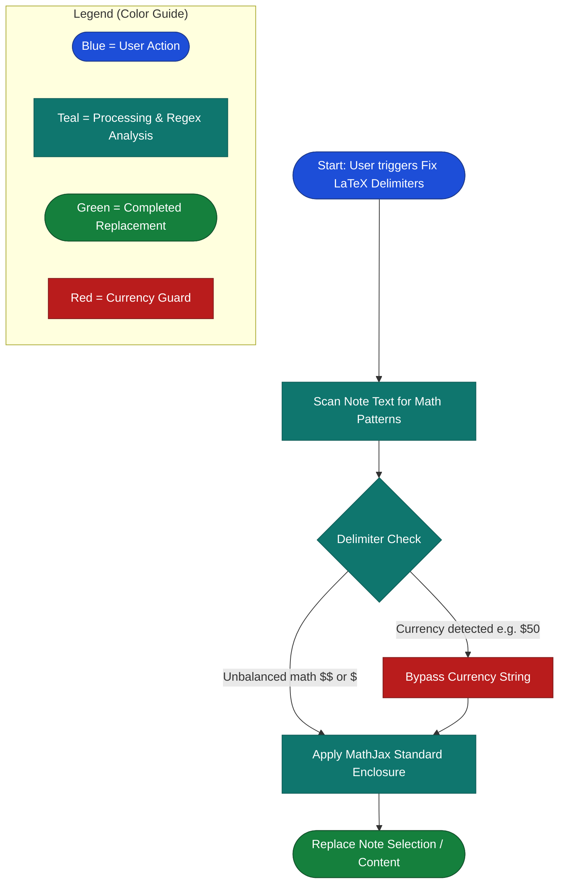

# Visual Feature & Change Log (`VISUAL_LOG.md`)
> **1-Line Summary:** Visual flowcharts explaining LaTeX Toolbox formula insertion and delimiter repair flows.

## Feature & Change Flowcharts

### [VISUAL: Delimiter-Fixer-Pipeline] | Aliases: fix latex workflow, equation normalization
> **1-Line Summary:** Scans active note, checks delimiter balance, and updates corrupted math blocks.

